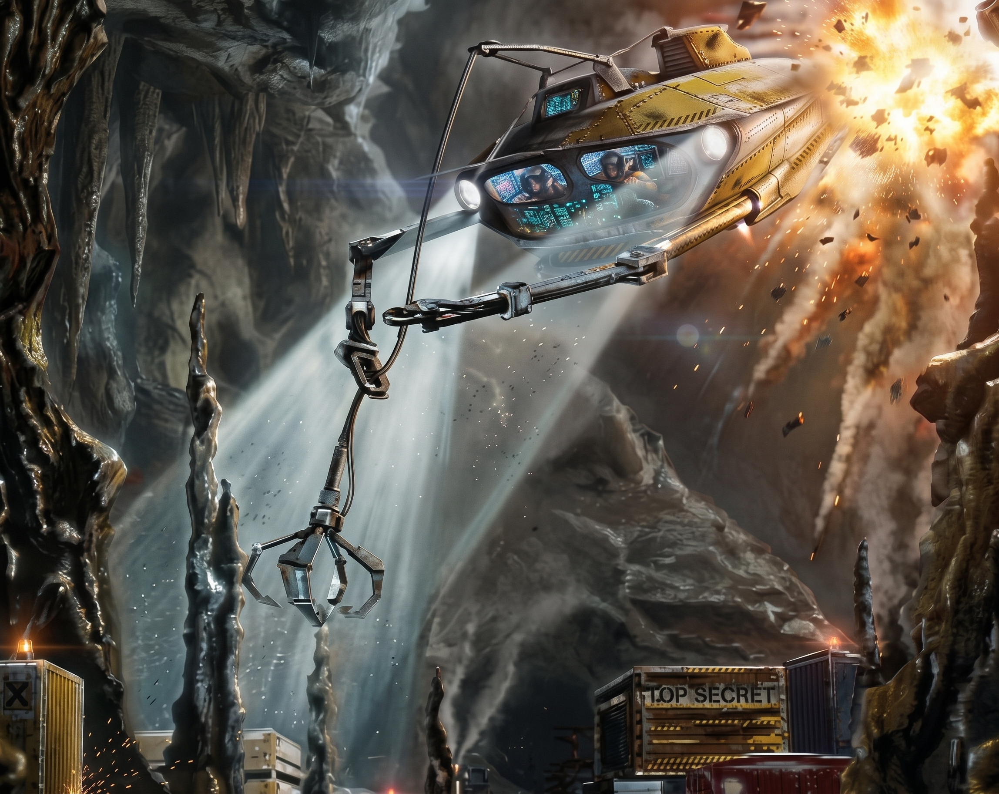

# Gravity-Farce

#### **There are many gravity games, a bunch of copy-cats and some predecessors.**  
### But `Gravity-Force` by Stephan Wenzler was simply the best.  

...it was on the backlog for 30-35 years but I finally got around to finding out **why** it was awesome.  
So, some hours (more than I will admit) thrown at reverse engineering it and ... we have a (in spirit) port that will run in the browser.  

It's awesome to see that a lot of old games are getting a second life these days! To manage expectations, this is not a direct port or conjured by agents. I've attempted to handpick the things that would help making it fun on modern machines in both multi- and single-player. Ignored some, extended others. It's very much a labour of love. All levels designs (single/multi/dogfight/racing), turret and enemy behaviour come from the original game. More on this below.  

## Deviations from the original

### Competitive play
Not really a deviation from the original game since that was all about competition! But I want to stress that
Gravity-Farce is _also_ written for competitive play. Exploitability (aka cheating) should be annoying enough
so that it's not worth it. I _will_ fix[1] issues that enable cheating*, please report them. The hi-scores should
mean something. Server admins can also review games.  

For fair competitiveness, I suggest you start a server with a region in mind since it can be pretty frustrating
with latency differences. To this day I have not done _much_ to even out the playingfield with differing latencies
but it is definitely on the list of things to add. The primary reason it's not in there yet is because it is a 
bit of a conflict with what the original Gravity-Force was: You _felt_ like you had full control, down to the pixel.
I mean, I know I counted on the nose of my ship literally being pixel-to-pixel against the wall in turns. So, yeah, I 
am worried that I will lose a bit of that feeling then! But, would have to test it and see!  

[1]: SOME types of cheating is close to impossible to fix in code due to the nature of networked play. Server admins can make their decisions on a case-by-case basis.

### 1. No split-screen and Server-side
I did not really fancy the split-screen for multi-player. I went for networked play instead. The server is 
supposed to be 100% authoritative, which means it should be hard(er) to cheat (why-people-why, let everyone 
enjoy things!). But, eh, anti-cheat is now a big-money industry so, yeah... No guarantees. 

### 2. Records, Rankings and Scores
Second big deviation, rankings. It's fun to be best!  
To me, the best part about Gravity-Force was multi-player. I think almost everyone will agree (except Fred).
The bummer was that you needed your mate in the same room for that sweet split-screen. There were ups and downs to this,
it was nice to give someone a punch on the arm when they were being an ass (read: won). And ... luckily I am a good winner. Anyway, I digress.  

This version of GF keeps track of all kinds of high-scores and records for both single and multiplayer globally. You don't have to snail-mail your mate your fastest time on the "8 race". You just race on the same server.  

_But obviously, multi-player is the way to go!_ `:D`

### 3. Bots, bots, bots
I also added _optional_ bots to the single-player disciplines. I'm quite pleased with them as they're dumb enough, and not too dumb.

### 4. Bump bump
Turrets and enemies in race courses optionally bump instead of one-shotting you (opens up more courses for fun racing). Toggle with server config flag `lethalRacingEnemies` (bumping is default).

### Not really a port
I have tried to get the _feeling_ correct. It is written from scratch. Essentially I started with a simple skeleton of what I thought would be in there and then I started digging in the 68K assembly code. There are a LOT of clones of Gravity-Force out there, but all of them have their own levels, pathing, missions. I wanted to get the original feeling back, but yeah, absolutely, there are subtle and not so subtle differences _everywhere_ in this version too! Hopefully all for the better!

## Party like it's 1989: Play It!
https://...

### Gameplay Tips
If using keyboard: fire bullets with one hand, control ship with the other (e.g. `w` to fire and numpad `4,5,6` for control).  
Oh, but I _DO_ believe playing the single player missions make you a better player (at least it pisses you off less when you die)!  

### Levels and Data
All levels (multi- and single player) and power-ups and similar structures are ported over from the
original game. For instance, all enemies and turrets should move pretty much exactly the same as 
in the original game. This is also why there is no map editor. There is documentation on some of
the funky stuff in the `doc` dir.

### Gamepads & Analog Precision
It was fun with a joystick but you had to master both the stick and the keyboard or you'd be screwed if some bespoke challenge came up. Due to this, I decided to add support for gamepads (only tested with an Xbox controller for now). First of all, it was absolutely horrible to have the old "joystick up" to fire with it, so other buttons to shoot are supported too. Second, I decided to add support for `analog thrust and steering`. Oh boy. Holy moly, did the game get easier in some cases. So, yeah:  

**Server Admins:** Analog precision gives players a competitive advantage, by default I have it `disabled` -- for that sweet digital experience. But you can set `"allowAnalogControl": true` in `server_config.json` if you want it differently. Regardless of that setting, gamepads/controllers will still work perfectly fine without analog controls, but will then require the same amount of work as a keyboard.

## Authoritative Server
Even with an authoritative server, players can still attempt several types of exploits in multiplayer. I document these 
things to encourage server admins to review sus games and get rid of their offenders. With a bit of practice you'll see 
them from miles away. You can always just send replays to me and I'll take a peek.

So these are pretty much impossible to completely combat with code:
* **ESP:** The server needs to broadcast player states earlier than what is currently in view to not have things plop into existance. This can be abused to see things early. I do minimize this distance, and I think it's a decent balance at the time. That said, don't ban _me_! I always spam bullet rains in the direction I think or know the enemy will come. It's not always easy to spot these and uncanny stuff happens. This is more about "this dude _always_ does 'this'..."  
* **Aimbots and Input Automation:** As with any game, an aimbot is _always_ possible. It would be possible if you played a video stream, you'd just train a model to detect your targets. These guys are easy to spot in most games, though.  
* **Lag Switching / Latency Manipulation:** Artificially delaying outgoing network packets or inducing packet loss can freeze a player's perceived position or cause erratic interpolation behavior on opponents' screens. This is not always easy to see, but if it only happens repeatedly when they are in a pickle... probably bye?  
* **Client is client:** The code is executed on their machine. We're not installing any root-kits like the big players are. Users can modify the game, alter rendering layer visibility etc. While server validation prevents direct score or position spoofing, UI-level modifications can still provide some advantage. BUT, I have put effort into making this very very minimal. I can imagine you might want to hide under a plant or so, but yeah, no. The plant won't let you (which is the other way around of the problem I am describing, but okay...).  
* **Hardware/Software Macroing:** Making full-out bots, I don't really have a problem with this, but please mark your bot as a bot when you register the pilot. Then you'll compete with other bots. I guess there are some other scenarios where automation is interesting too, perhaps for auto-fire. "Joystick murder ftw" can be circumvented, but yeah, the rapid fire is capped. Anyway, let bots play bots!  

Maybe with some trained models it could be automated, but there would always be false positives -- a good player is a good player, and banning them is just a shame. But hey, cheaters are worse. Don't be too good? :)

### Amiga
Oh how awesome you were. I have not used any emulator or a real Amiga in decades,
and what really surprised me was that while digging around in the 68k code
I realized how much of the Amiga hardware and 68k was still SO familiar. Decades!
Even small annoyances like memory R/W breakpoints that never hit felt like a good friend. 
Track-loaders and DMA getting screwed up by breakpoints: ah. Almost comforting.  

...and after a few days I found out that the WinUAE debugger had `HH`.  
...and after that I learned I could dump all code with radare instead of sitting in the debugger.  
...but I had forgotten all about $dff006 ...  I could not make heads or tails out of waypoint tiles due to it. Quite a few hours were spent on getting enemy movement right due to this.  
...and again, the enemy movements, they have screwed me over again and again. I ended up creating a simulator that generates a track they should move along instead of trying real-time counting of frames and simulating VHPOSR for junctions. I consider myself defeated. But ah, the simulator works really well!  

Luckily, if you're old enough to remember Amiga fondly, you have no hair any more. Well, not me anyway. So, no hair lost this time around.

### The funkies
I (and my good friend, the LLM) have tried to document as much of the weirder details as I could in `doc`, but some were lost along the way.  
There was replay functionality at least partially implemented in the original Gravity-Force, but it did not make it into the final game. I have added it to this version, but only if you get a ranked result.

## Your own server
... todo ...   
You can run Gravity-Farce on your own hardware or server. You need a bit of CPU since all physics run on the server.
But really, I run it on a $10 / month VPS and I think it can host quite a bunch of players and bots without issues.  

You can also set a limit of number of simultaneous players you want to allow.

### Installing server
- grab the tar, unpack, cd gravityfarce, start screen, `node index.cjs`, ctrl+a and ctrl+d, ctrl+d. check.

### Managing server
- highscore reset
- player caps
- ...other server settings

### Disclaimer
Generative models were obviously used. I had fun creating it. _Creating things_ was always the fun part, the tools 
used were always rather secondary.  

At the end of the day, nothing changed: Shit still takes time.
